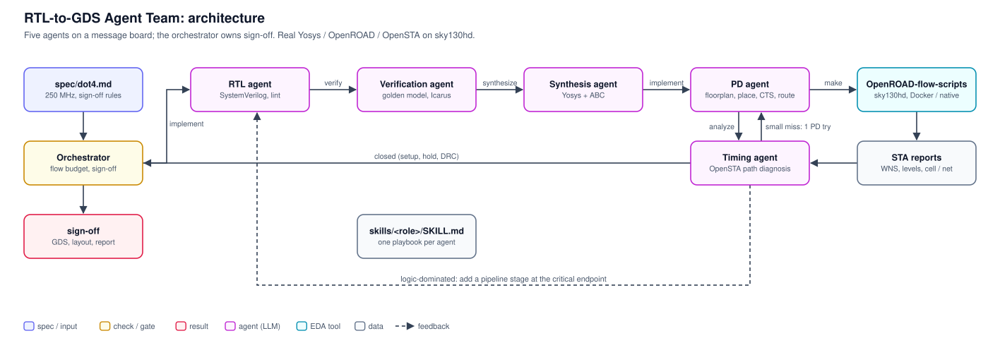
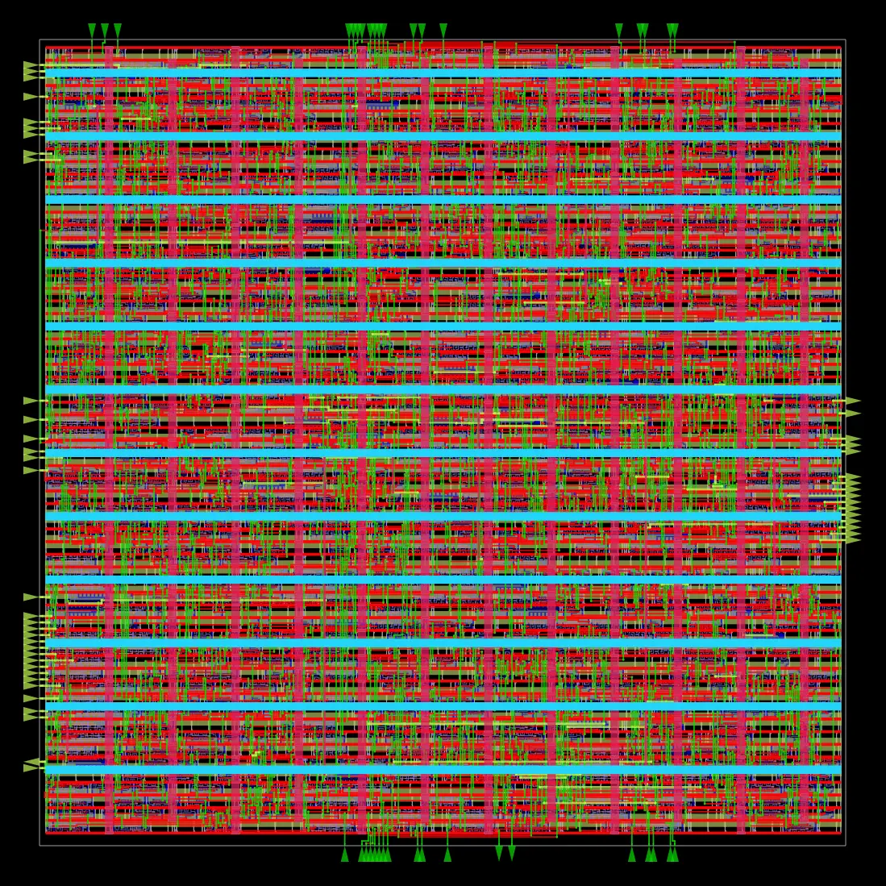
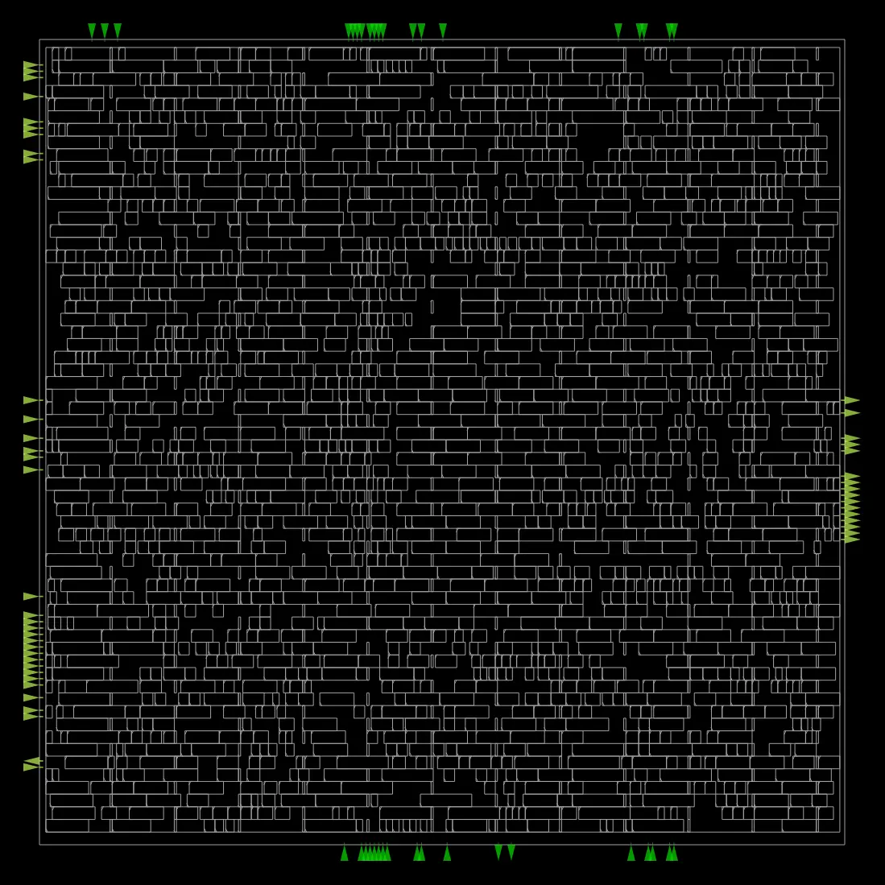
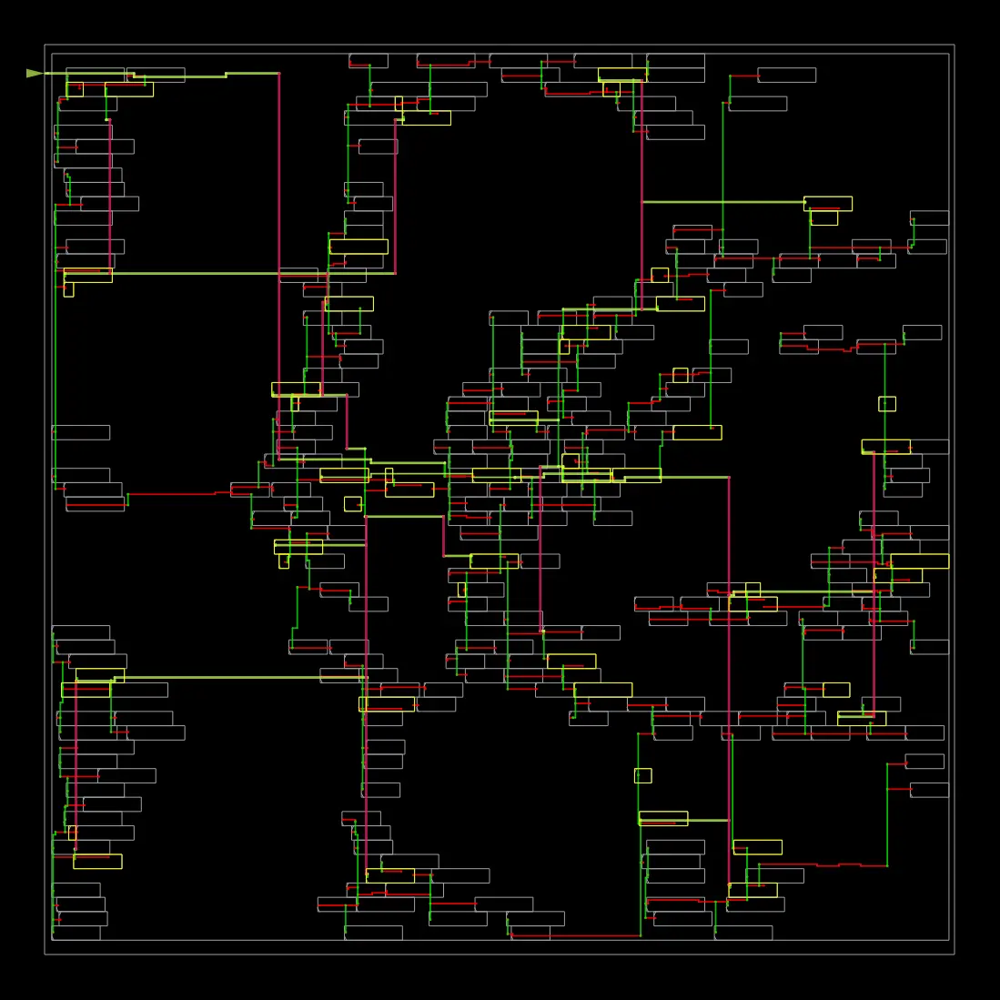
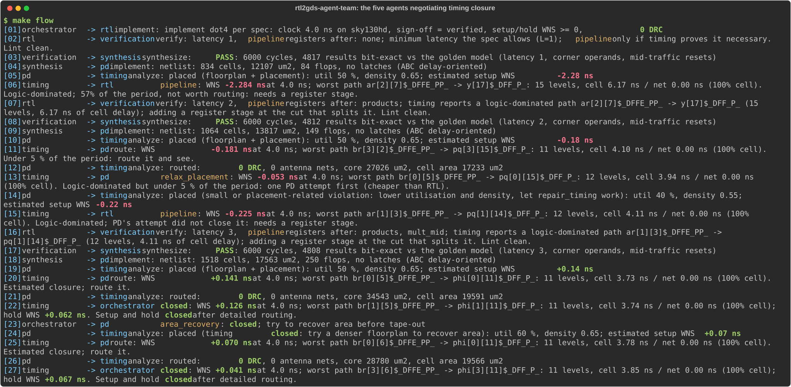
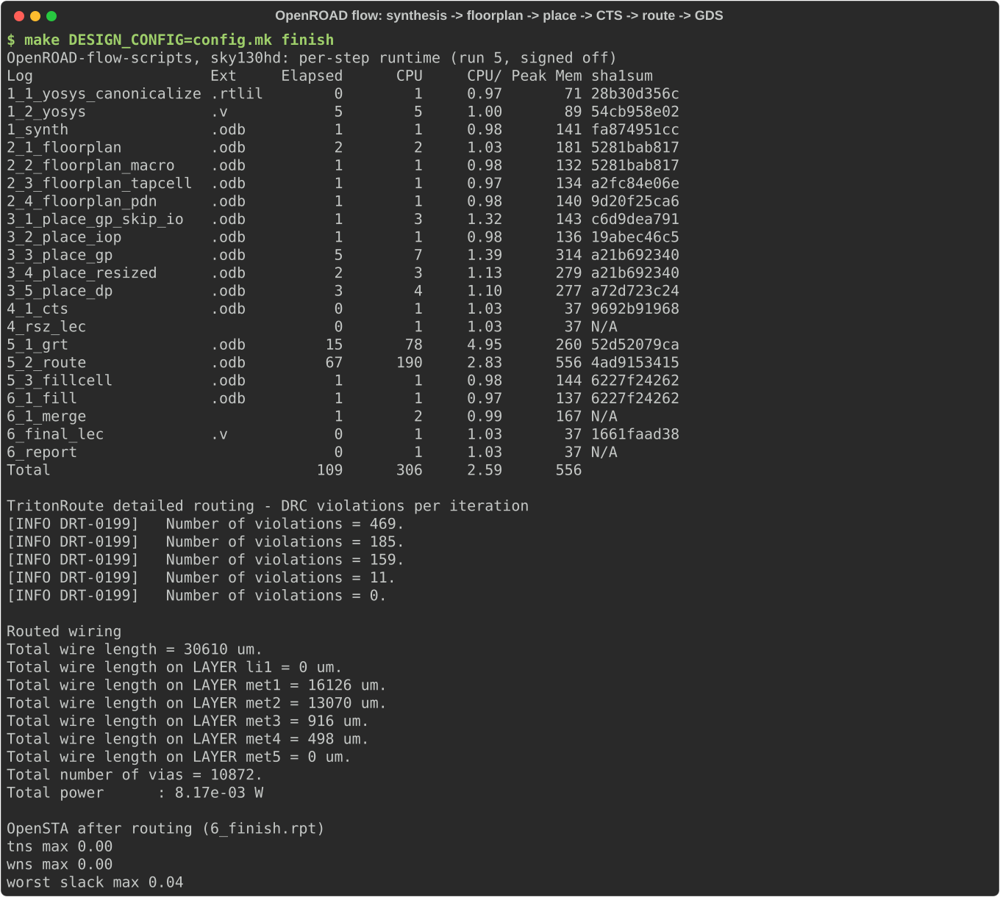
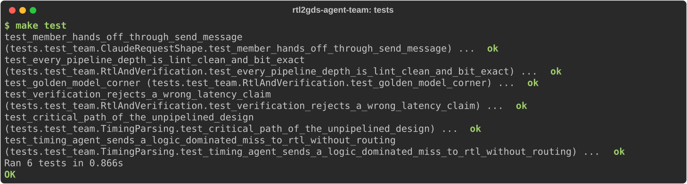

# RTL-to-GDS Agent Team

[](https://github.com/Ana2601/rtl2gds-agent-team/actions/workflows/ci.yml)

Five cooperating agents take a chip-level spec to a **signed-off GDS on SkyWater sky130**:

| Agent | Tools | Skill |
|---|---|---|
| **RTL** | SystemVerilog generator / writer, Verilator lint | [`rtl-design`](skills/rtl-design/SKILL.md): start at minimum latency, reset only control state, pipeline only when timing proves it, choose the cut |
| **Verification** | Python golden model, Icarus testbench, cycle-exact scoreboard | [`verification`](skills/verification/SKILL.md): model from the spec, corner and reset vectors, check the claimed latency, every RTL change re-verified |
| **Synthesis** | Yosys + ABC via OpenROAD-flow-scripts | [`synthesis`](skills/synthesis/SKILL.md): SDC with I/O budgets, delay-oriented mapping, latch / flop-count / area checks |
| **Physical design** | OpenROAD floorplan, PDN, global and detailed placement, CTS, global route, TritonRoute, fill | [`physical-design`](skills/physical-design/SKILL.md): utilisation and density knobs, DRC convergence, area recovery after closure |
| **Timing** | OpenSTA reports, critical-path parser (levels, cell vs net delay) | [`timing-analysis`](skills/timing-analysis/SKILL.md): logic- vs wire-dominated diagnosis, who fixes what, never touch the clock |

They talk through typed messages on a shared board. The **orchestrator** owns the
sign-off criteria and the flow budget:

- the final RTL is verified;
- setup and hold WNS ≥ 0 after detailed routing;
- 0 DRC and 0 antenna violations;
- a GDS is written.



Each agent runs under one of two policies:

- **`expert`**: the agent's `SKILL.md` rules as deterministic code. Reproducible, and
  what CI runs.
- **`claude`**: each agent is a Claude (`claude-opus-5-5`) tool-use loop. It reads the
  same skill, drives the same tools, and hands off by sending a message.

The orchestrator and its sign-off stay deterministic in both modes.

## Result: signed-off GDS at 250 MHz on sky130

Produced by `make flow` (expert policies), CI re-runs it end to end. Full log:
[`results/summary.md`](results/summary.md).

| Sign-off item | Result |
|---|---|
| Architecture the team converged on | pipeline depth 3: registers after the products **and inside the multipliers** |
| Clock | 4.0 ns (250 MHz), sky130hd typical |
| Setup WNS / TNS | **+0.041 ns / 0.000 ns** |
| Hold WNS | +0.067 ns |
| DRC / antenna violations after detailed routing | **0 / 0** |
| Core area / cell area | 28,780 µm² / 19,566 µm² (68 % utilisation) |
| Power (typical, default activity) | 8.2 mW |
| Verification of the final RTL | 4,808 results over 6,000 cycles, bit-exact, latency checked |
| Output | `results/signoff/dot4.gds`, `results/signoff/dot4.sv` |

| Routed layout (OpenROAD) | Placement | Clock tree |
|---|---|---|
|  |  |  |

### How the team got there: five OpenROAD runs

| Run | Depth | Util / density | Placement WNS | Routed WNS | Decision |
|---:|---:|---|---:|---:|---|
| 1 | 1 | 50 % / 0.65 | −2.284 ns | (not routed) | **Timing → RTL.** 15 levels, 6.17 ns of cell delay, 57 % over the period: "not worth routing", add a register stage |
| 2 | 2 | 50 % / 0.65 | −0.181 ns | −0.053 ns | Under 5 %, so **PD gets one try first**. The worst path now *ends at the product registers* |
| 3 | 2 | 40 % / 0.55 | −0.225 ns | (not routed) | PD's relaxed floorplan made it worse (the path is all cell delay) → **Timing → RTL** |
| 4 | 3 | 50 % / 0.65 | +0.141 ns | **+0.126 ns** | The RTL agent read the endpoint (`pq`, the product register) and **split the multiplier itself**, not the adder tree. Closed; 0 DRC |
| 5 | 3 | **60 %** / 0.65 | +0.070 ns | **+0.041 ns** | Orchestrator: closed, so try to recover area. **The core shrank 17 %** (34,543 → 28,780 µm²) and stayed closed and DRC-clean. Signed off |





Two decisions are the point here:

- **The cut placement.** A depth-3 design with the extra register after the first adder
  level still fails (measured: −0.178 ns). The multiplier, not the adder, is the
  bottleneck. The team gets this right because the Timing agent passes the critical
  path's endpoint, and the RTL skill maps endpoints to cuts.
- **The rule change that led to it.** The first full run used a rule requiring more
  than 12 logic levels to call a path logic-dominated. That made the Timing agent misread
  a 12-level, all-cell-delay path as wire-dominated, and PD wasted three runs lowering
  density. The fix is in the skill: 6 or more levels, and **PD gets one attempt, then
  RTL**. There is also a note that on small sky130 blocks, wire delay shows up as cell
  delay.

## The design

[`spec/dot4.md`](spec/dot4.md) is a 4-lane signed 8-bit dot product
(`y = Σ a_k·b_k`, 18-bit exact result) with full throughput. **The clock is fixed
at 4.0 ns (250 MHz)**, and the pipeline depth is the implementer's choice, from 1 to 4
stages.

The single-cycle version needs about 6 ns of logic: an 8×8 multiplier followed by an
adder tree, 15 logic levels. So the team has to discover, from real timing reports, how
much pipelining it needs and where the registers go. The RTL agent's design space:

| Depth | Extra registers after |
|---:|---|
| 1 | (none) |
| 2 | the products |
| 3 | the products and the first adder level |
| 4 | those, plus inside the multipliers (split partial products) |

The Verification agent checks every depth bit-exact against the golden model before it
may be synthesised.

## Run it

`make flow` needs OpenROAD-flow-scripts. It runs natively inside the `openroad/orfs`
container, as CI does. Elsewhere it starts that image through Docker; on Apple Silicon
it runs under emulation, at roughly 3–6 minutes per flow run.

```bash
make test        # generator + verification at every depth, STA parser, agent decisions (~5 s)
make flow        # the team, expert policies: spec -> GDS, writes results/
make check       # sign-off criteria hold
```

With Claude driving every agent:

```bash
pip install -r requirements.txt
export ANTHROPIC_API_KEY=...
make live        # writes results_live/
```



## Layout of the results

| Path | Contents |
|---|---|
| `results/summary.md` | Sign-off table, every flow run, the full team message log |
| `results/report.json` | The same, machine-readable, including the parsed critical path of each run |
| `results/signoff/` | `dot4.gds`, the signed-off `dot4.sv`, and OpenROAD's layout renders (`final_all.webp`, placement, clock tree, congestion) |

## Honest notes

- **What `make flow` runs.** It uses the expert policies, so CI is deterministic and
  needs no API key. The `claude` policy is exercised only by unit tests with a stub
  client, until it is run with a key.
- **The expert RTL agent chooses from a design space; it doesn't write free-form code.**
  It picks among verified micro-architectures (pipeline depth and cut placement) that a
  generator renders. The Claude RTL agent writes the module itself, under the same lint
  and verification gates.
- **Sign-off scope.** It uses the sky130hd typical corner only, with OpenROAD's
  parasitic estimation and extraction, as ORFS does. It is not multi-corner and not
  foundry sign-off. That is the right level for a portfolio flow, not a tape-out.

## Related work

[ORFS-agent](https://arxiv.org/html/2506.08332v2) tunes OpenROAD-flow-scripts
parameters with an LLM. This project is a *team* covering the whole path, RTL included:

- a timing diagnosis that decides **whether the fix belongs in RTL or in PD**;
- verification gating every RTL change;
- an orchestrator that will not accept a result that misses sign-off.

Part of a hardware portfolio. See also
[rtl-ppa-optimizer-agent](https://github.com/Ana2601/rtl-ppa-optimizer-agent) and
[uvm-testbench-generator-agent](https://github.com/Ana2601/uvm-testbench-generator-agent).
